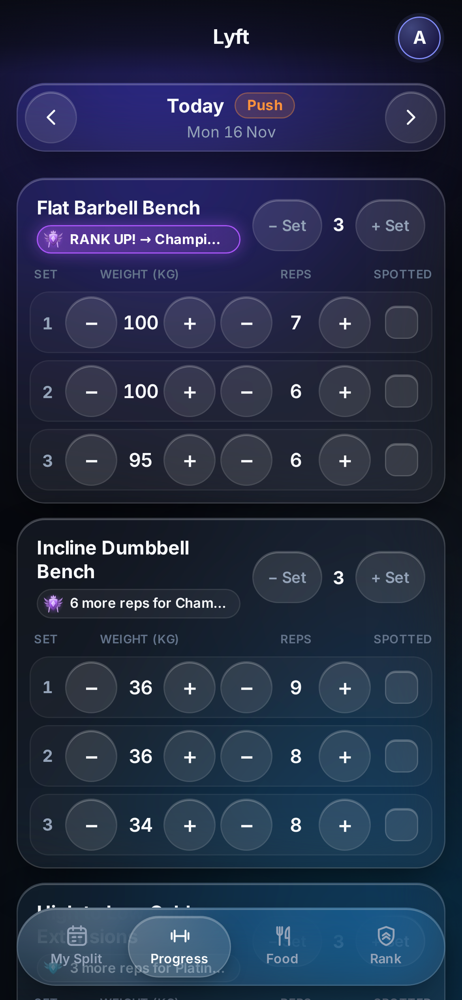
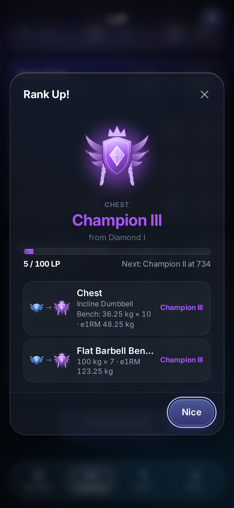
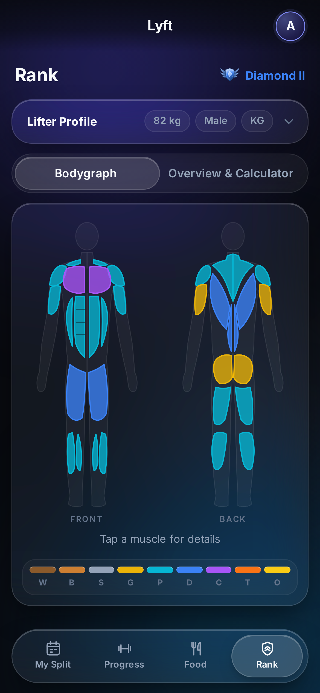
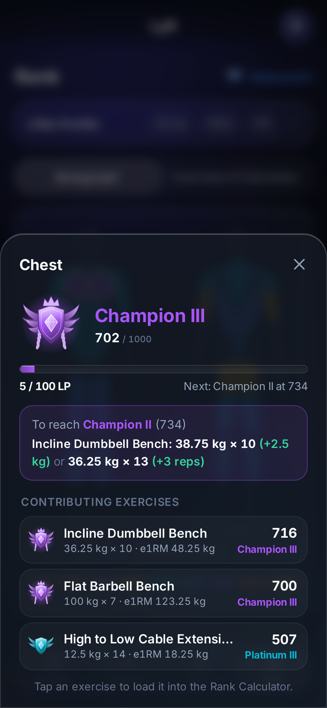
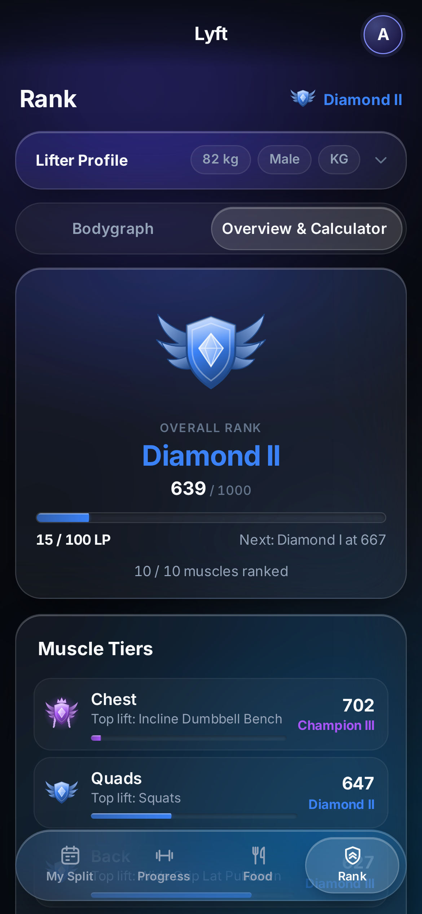
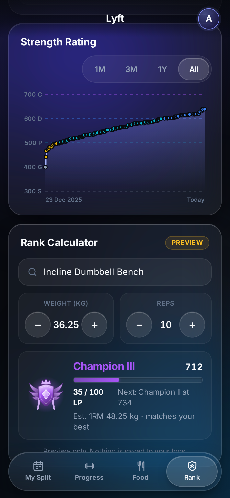
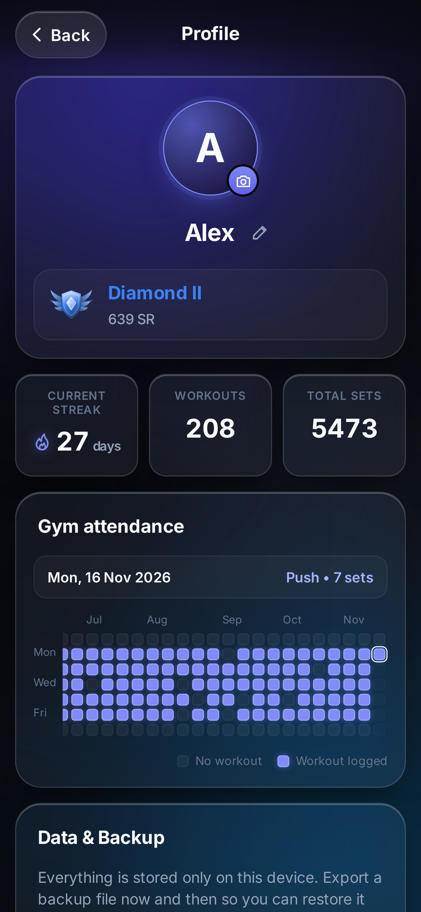
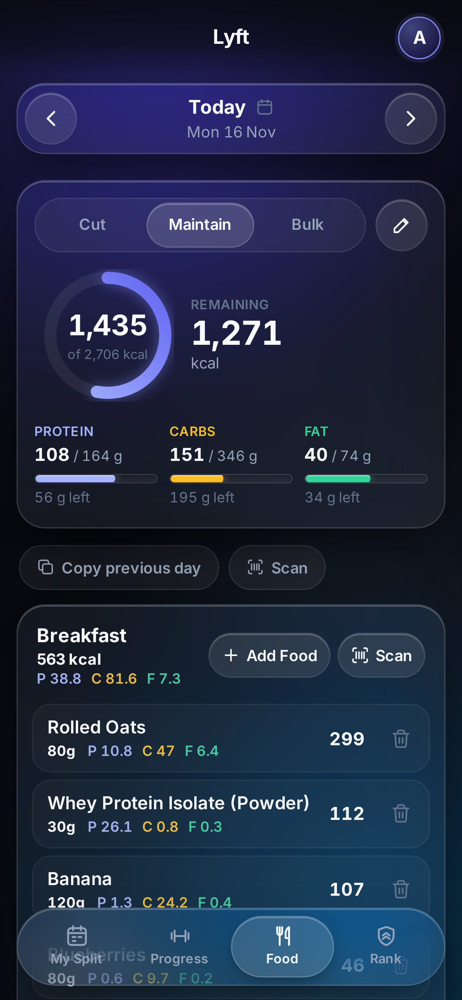
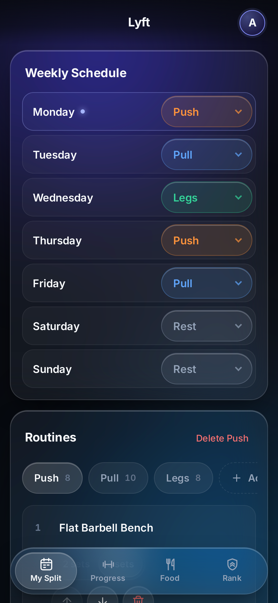

# Lyft

A gym tracker that turns every set you log into a strength rank, from Wood to Olympian, with a food diary and a streak to keep you coming back. No accounts, no subscriptions: your data stays on your own devices.

**Try it on your phone:** https://bonniciethan.github.io/Lyft/ · **Downloads (Android, Linux):** [latest release](https://github.com/BonniciEthan/Lyft/releases/latest)

<table>
  <tr>
    <td align="center"><br><sub>Log sets, see rank-ups live</sub></td>
    <td align="center"><br><sub>Rank up after a workout</sub></td>
    <td align="center"><br><sub>Every muscle has a tier</sub></td>
  </tr>
  <tr>
    <td align="center"><br><sub>Know exactly what's next</sub></td>
    <td align="center"><br><sub>Overall rank, Wood to Olympian</sub></td>
    <td align="center"><br><sub>Track strength over time</sub></td>
  </tr>
  <tr>
    <td align="center"><br><sub>Streaks and a year of attendance</sub></td>
    <td align="center"><br><sub>Calories, macros and barcode scanning</sub></td>
    <td align="center"><br><sub>Plan your weekly split</sub></td>
  </tr>
</table>

## Self-hosting

A self-hosted personal gym tracker. One React + Vite front end, served three ways:

| Target | How |
| --- | --- |
| Home server (CasaOS) | Docker image: Express + SQLite on port `3457`, serving the built UI |
| Phone | Open `http://<SERVER_IP>:3457`, then Add to Home Screen |
| Zorin OS / Ubuntu desktop | Tauri v2 `.deb` wrapping the same UI |

Sync only happens when you tap a button. Every edit is saved to `localStorage` straight away, **Save** pushes the whole state to the server, and **Load** pulls it back. Nothing polls in the background.

```
.
├── Dockerfile               multi-stage: build client → server deps → lean runtime
├── docker-compose.yml       CasaOS-ready (x-casaos metadata)
├── server/                  Express + better-sqlite3 API (port 3456)
└── client/                  React + Vite UI
    ├── public/              manifest.json, icons
    ├── src/                 app code (seed.js, lib/, components/)
    └── src-tauri/           Tauri v2 desktop wrapper (.deb)
```

## 1. Deploy on the home server (CasaOS)

Copy this folder to the server, then:

```bash
sudo mkdir -p /DATA/AppData/lyft
docker compose up -d --build
```

Or in CasaOS: **App Store → Custom Install → Import** and paste `docker-compose.yml`. CasaOS cannot build images, so run `docker build -t lyft:latest .` on the server first.

The database is at `/DATA/AppData/lyft/gym.db`. On first start it is seeded with the default split, routines and goal. To back up, copy that file. The CasaOS tile icon is the `wger` icon from dashboard-icons; change `icon:` in the compose file if you want a different one.

API:

- `GET /api/health` returns `{ status, timestamp }`
- `GET /api/sync` returns the full state
- `POST /api/sync` validates the body, replaces the stored state and returns `{ success, lastSynced }`

## 2. Phone

Open `http://<SERVER_IP>:3457` (LAN) or `http://<tailscale-ip>:3457`, then use Share → **Add to Home Screen**. Leave the Server URL in Settings blank, because relative `/api` calls go to the server the page came from.

## 3. Desktop `.deb` (Zorin OS 17)

One-time prerequisites:

```bash
sudo apt update
sudo apt install -y libwebkit2gtk-4.1-dev build-essential curl wget file libxdo-dev libssl-dev libayatana-appindicator3-dev librsvg2-dev
curl --proto '=https' --tlsv1.2 -sSf https://sh.rustup.rs | sh
```

Node.js 20+ is also required.

Build:

```bash
cd client
npm install
npm run tauri:build
```

Install the package from `client/src-tauri/target/release/bundle/deb/`:

```bash
sudo apt install ./client/src-tauri/target/release/bundle/deb/Lyft_1.1.0_amd64.deb
```

On first launch, open the gear icon, set **Backend Server URL** to `http://192.168.x.x:3457` (or your Tailscale IP), tap **Test Connection**, then **Save**, and then **Load**.

## Local development

```bash
cd server && npm install && npm start        # API on :3456 (data in ./data; set PORT to change)
cd client && npm install && npm run dev      # Vite on :5173, proxies /api → :3456
cd client && npm run tauri:dev               # desktop window against Vite
```

## Data model

```jsonc
{
  "lastSynced": "ISO string | null",
  "split":    { "Monday": "Push", ... "Sunday": "Rest" },
  "workouts": { "Push": [{ "id", "name", "defaultSets" }], ... },
  "logs": {
    "2026-11-13": {
      "category": "Pull",
      "exercises": [
        { "exerciseId": "pull-1", "name": "Wide Grip Lat Pulldown",
          "sets": [{ "weight": 62.5, "reps": 10, "spotted": false }] }
      ]
    }
  },
  "goals": [{ "id", "exercise", "startPR", "currentPR", "targetPR", "targetDate", "notes", "achieved" }],
  "profile": { "bodyweight": 80, "sex": "male", "unit": "kg", "bodyweightHistory": [{ "date", "weightKg" }],
               "displayName": "Lifter", "avatarDataUrl": "data:image/webp;base64,… | null" },
  "nutrition": {
    "days": {
      "2026-11-15": {
        "breakfast": [{ "id", "foodId": "rolled-oats", "name", "brand", "unit": "g", "grams": 80,
                        "per100g": { "calories": 374, "protein": 13.5, "carbs": 58.7, "fat": 8 } }],
        "lunch": [], "dinner": [], "snacks": []
      }
    },
    "foods": [/* custom foods, optionally with a barcode */],
    "meals": [/* saved meal presets: { "id", "name", "items": [entry] } */],
    "goal": "cut | maintain | bulk",
    "activity": 1,
    "manual": { "calories": null, "protein": null, "carbs": null, "fat": null }
  }
}
```

A day is only written to `logs` once you edit something on it, so browsing the calendar never creates empty entries.

## Food tab

Log food from a bundled database of about 390 European/metric foods (values per 100 g or per 100 ml), from your own custom foods, or by barcode. There are no paid APIs and no accounts:

- **Packaged foods** come from [Open Food Facts](https://world.openfoodfacts.org), which is free and needs no key. Every product scanned is cached in `localStorage` (`lyft_off_barcode_cache_v1`), so repeat scans resolve instantly. A barcode that isn't found opens a pre-filled "Add New Barcode Food" form, and that food then scans from your own data.
- **Barcode scanning** uses the browser's native `BarcodeDetector` where it exists (Chrome, Edge, Android), with the open-source `@zxing/browser` as a lazy-loaded fallback for Safari, Firefox and the desktop app.
- **The live camera needs a secure context**: HTTPS, `localhost` or the desktop app. On a plain `http://<LAN-IP>` address the browser hides the camera, so the scanner falls back to **Take Photo** (which opens the phone's camera app) plus manual number entry.
- **Targets** come from the Lifter Profile: maintenance is 33 kcal/kg for males and 30 kcal/kg for females, times an activity factor. Cut is −400 kcal with 2.2 g/kg protein and 0.8 g/kg fat. Maintain is 2.0 g/kg protein and 0.9 g/kg fat. Bulk is +300 kcal with the same macros as Maintain. Carbs fill the remaining calories. You can override any target manually.

## Lyft Local on the web (GitHub Pages)

The standalone edition is also hosted at **https://bonniciethan.github.io/Lyft/**. It works on any iPhone or Android phone and needs no server or account. Each person's data stays in their own browser.

- **iPhone (Safari):** open the link, tap Share → **Add to Home Screen**, then open Lyft from the icon.
- **Android (Chrome):** open the link, then tap **Install app** (or ⋮ → Add to Home screen).
- **Updating:** nothing to do. Each deploy replaces the app at the same link. Open Lyft from the home-screen icon while online and the newest version loads; data is kept (it lives in the browser's storage for the site, which deploys don't touch).
- **Profile** (your photo or initial, top right): name, photo, overall rank, current streak, totals and a 53-week attendance grid. Scheduled Rest days keep a streak alive; a missed training day ends it.
- **Backup & Restore** (Profile → Data & Backup): exports everything (workouts, food diary, custom foods, saved meals, targets, scanned products) to a `.json` file via the share sheet or a download, and restores it on any device. Data is otherwise stored only on the device.
- The live camera scanner works because the site is HTTPS. After the first visit the app opens offline; food lookups still need a connection.
- To publish changes, commit them and run `bash scripts/deploy-pages.sh`. It tests, builds, and pushes the files to the `gh-pages` branch that Pages serves. The offline service worker is generated at build time by [`client/sw-plugin.js`](client/sw-plugin.js) and is only registered by the local edition on HTTPS.

## Android app (APK)

`client/android/` is a [Capacitor](https://capacitorjs.com) project that wraps the Lyft Local web build into an installable Android app (`com.personal.lyft.local`). Its version comes from `client/package.json`; for example, 1.3.0 becomes versionCode 10300.

```bash
cd client && npm run build:apk   # → android/app/build/outputs/apk/release/app-release.apk
```

Requirements: JDK 21 (`JAVA_HOME`) and the Android SDK (`ANDROID_HOME`, platform 36 + build-tools). Release signing reads `~/.config/lyft-android/keystore.properties` (`storeFile`, `storePassword`, `keyAlias`, `keyPassword`). The keystore is **not** in the repo. Keep a backup of it, because every future APK must be signed with the same key to install as an update over the previous one.
